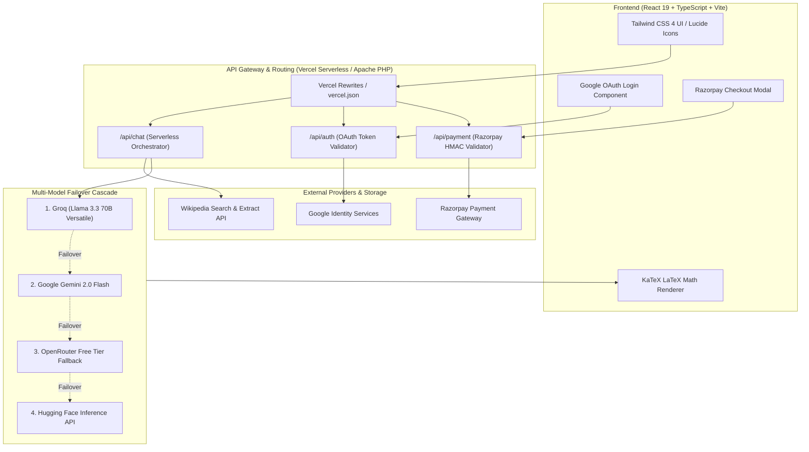
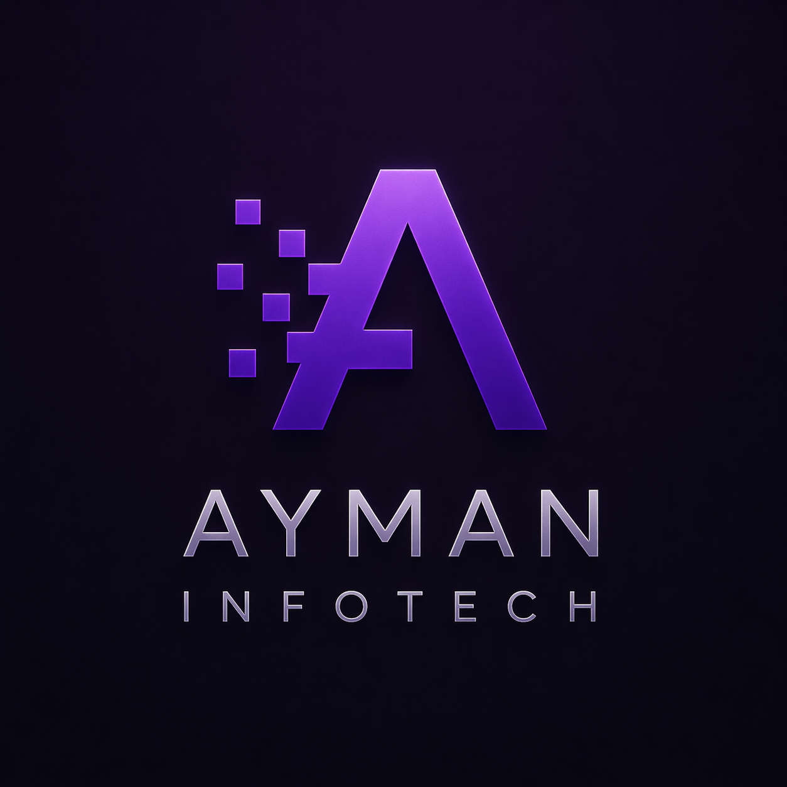

# 🎓 AYMAN STUDY AI

> **An enterprise-grade, multi-model AI academic tutoring and exam preparation platform built with React 19, TypeScript, Vite, and serverless LLM orchestration.**

[](https://vercel.com/new/clone?repository-url=https%3A%2F%2Fgithub.com%2FMohammedAyman07%2Fayman-study-ai&env=GEMINI_API_KEY,GROQ_API_KEY,RAZORPAY_KEY_ID,RAZORPAY_KEY_SECRET,VITE_RAZORPAY_KEY_ID,VITE_GOOGLE_CLIENT_ID)
[](https://react.dev/)
[](https://www.typescriptlang.org/)
[](https://tailwindcss.com/)
[](LICENSE)

---

## 📌 Executive Overview

**AYMAN STUDY AI** is an intelligent educational platform tailored for secondary, higher secondary (Classes 9–12), and competitive examination aspirants. 

Unlike generic chatbots that output unverified conversational summaries, AYMAN STUDY AI acts as a **strict, exam-marking tutor**. It enforces academic rigor, producing step-by-step LaTeX-formatted mathematical solutions, balanced chemical reactions, structured biological points, historical timelines enriched via Wikipedia API, and automated Mermaid.js diagrams.

The platform is engineered with an intelligent **multi-model failover engine** (orchestrating Groq Llama 3.3, Google Gemini 2.0, OpenRouter, and Hugging Face), ensuring 99.9% uptime with zero vendor lock-in.

---

## 🎯 Problem Statement & Solution

### The Problem
* **Hallucinations in Generic Chatbots:** General-purpose AI models often provide superficial or factually incorrect mathematical derivations and exam explanations.
* **Lack of Formal Exam Structure:** Students lose marks because standard AI outputs conversational paragraphs instead of standard marking-scheme sections (*Given, To Find, Formula, Step-by-Step Calculation, Final Answer*).
* **Vendor Downtime & Rate Limits:** Single-provider AI apps frequently fail when APIs encounter rate limits or outages during exam periods.
* **Manual Note Digestion:** Reviewing dense academic textbooks and past papers requires tedious keyword extraction and manual flashcard generation.

### The Solution
* **Rigorous System Prompting & Formatting:** Strict prompt governance ensures every response follows formal exam-board criteria with vertical LaTeX display math blocks (`$$ ... $$`).
* **Multi-Provider Failover Architecture:** Automatic cascade across high-speed LPU inference (Groq Llama 3.3 70B), Google Gemini 2.0 Flash, OpenRouter, and Hugging Face.
* **Snap & Solve Vision AI:** High-precision OCR extracts questions from uploaded textbook photos or handwritten answer sheets.
* **Self-Contained Evaluation Modules:** Interactive AI Quiz Generator and Unit-wise Question Banks allow students to self-assess with immediate scoring and analytical reviews.

---

## 🚀 Key Features (Verified & Implemented)

### 1. 🧮 Multi-Subject AI Exam Solver (13+ Disciplines)
Dedicated AI study buddies tuned for specific textbook syllabi:
* **STEM:** Mathematics, Physics, Chemistry, Biology, Botany, Zoology, Computer Science.
* **Humanities & Languages:** English Literature, Tamil Grammar & Literature, History (with live Wikipedia context injection).
* **Commerce & Finance:** Commerce, Accountancy, Economics.

### 2. 📸 Snap & Solve (Vision AI)
* Supports drag-and-drop or file upload of question photos (PNG, JPEG, WebP).
* Automatically encodes images to base64, invokes multimodal vision models (`llama-3.2-11b-vision-preview`, `gemini-2.0-flash`, `Qwen2-VL-7B-Instruct`), and returns formatted answers.

### 3. 📐 Exam-Oriented Step-by-Step Solutions
* Formats answers strictly into structured exam booklets:
  * **--- SOLUTION ---**: Pure vertical mathematical steps in KaTeX LaTeX.
  * **--- FINAL ANSWER ---**: Highlighted boxed conclusion with SI units.
  * **--- EXPLANATION ---**: Pedagogical breakdown of principles.
  * **--- KEYWORDS ---**: Critical exam grading terms.
* Generates live **Mermaid.js charts and circuit diagrams** dynamically when visual explanations are needed.

### 4. 📝 AI Quiz Generator & Assessment Engine
* Generates customized Multiple Choice Question sets on any topic.
* Configurable parameters: target class/grade level (Class 9 through College) and question volume.
* Interactive test runner with instant feedback, question-by-question review, timer, and score analytics.

### 5. 📚 Pre-loaded Physics Question Bank
* Curated chapter-wise MCQ question banks for Physics (Electrostatics, Current Electricity, Magnetism, and Electromagnetic Induction) with immediate answers and rationales.

### 6. 🔍 Exam Answer Summarizer & Keyword Extractor
* Analyzes lengthy essay answers or scanned notes.
* Extracts high-yield exam keywords and generates bulleted concept summaries for quick revision.

### 7. 💬 Context-Aware "Study Buddy" Chatbot
* Embedded discussion thread beneath every solved problem.
* Retains solved problem context to explain specific steps, clarify doubts, or provide alternative derivation methods.

### 8. 🔐 Authentication & Credit Economy
* Google OAuth 2.0 Sign-In with 20 initial complimentary credits.
* Automatic IP geolocation detection (`ipapi.co`) adjusting checkout currency dynamically (INR for India, EUR for Europe, USD internationally).
* Razorpay payment gateway integration for real-time credit top-ups.

---

## 🏗️ System Architecture



---

## 💻 Tech Stack

| Layer | Technologies |
|---|---|
| **Frontend Framework** | React 19.0, TypeScript 5.8, Vite 6.2 |
| **Styling & Motion** | Tailwind CSS 4.1, Framer Motion (`motion/react`), Lucide React |
| **Math & Markdown** | KaTeX 0.16, `react-markdown`, `remark-math`, `rehype-katex`, `remark-gfm` |
| **Serverless Backend** | Vercel Serverless Functions (Node.js / TypeScript) |
| **Legacy / LAMP Backend** | PHP 8.2+, PDO MySQL, cURL, Apache `.htaccess` |
| **AI LLM Inference** | Groq LPU API, Google Gemini API, OpenRouter, Hugging Face Inference |
| **External Integrations**| Google OAuth 2.0, Razorpay Gateway, Wikipedia REST API, `ipapi.co` |

---

## 🔒 Security & Defense-in-Depth

Security was an absolute priority during the refactoring of AYMAN STUDY AI:

1. **Zero Client-Side Exposure:** Private API keys (`GROQ_API_KEY`, `GEMINI_API_KEY`, `OPENROUTER_API_KEY`, `HUGGINGFACE_API_KEY`, `RAZORPAY_KEY_SECRET`, `DB_PASS`) are strictly confined to server-side environments. No private keys are injected into frontend bundles.
2. **Payment Integrity:** Razorpay transactions verify HMAC-SHA256 signatures server-side using cryptographic secrets before any student credit balance is adjusted.
3. **Authentication Verification:** Client-supplied Google OAuth ID tokens are verified server-side via Google's `tokeninfo` endpoint to prevent token forgery.
4. **CORS & HTTP Security Headers:** Vercel deployment enforces `X-Content-Type-Options: nosniff`, `X-Frame-Options: DENY`, `X-XSS-Protection: 1; mode=block`, and strict referrer policies.
5. **Failover Safety:** Redundant API keys can be passed as comma-separated lists (`GROQ_API_KEYS`, `GEMINI_API_KEYS`) enabling round-robin retry without key exhaustion.

---

## 📸 Application Screenshots

| Student Dashboard & Solver | AI Quiz Assessment |
|:---:|:---:|
|  <br> *Multi-Subject Interface with KaTeX Formulas* |  <br> *Real-time MCQ Generation & Score Analytics* |

> *Note: Place your production screenshots in `public/screenshots/` and update these links.*

---

## ⚙️ Local Development Setup

### Prerequisites
* **Node.js**: v18.0.0 or higher (v20+ recommended)
* **npm**: v9.0.0 or higher
* *(Optional)* **PHP 8.1+ & MySQL** if running the legacy Apache backend locally.

### Step 1: Clone the Repository
```bash
git clone https://github.com/MohammedAyman07/ayman-study-ai.git
cd ayman-study-ai
```

### Step 2: Install Dependencies
```bash
npm install
```

### Step 3: Configure Environment Variables
Copy `.env.example` to `.env`:
```bash
cp .env.example .env
```
Fill in your API keys in `.env`:
```env
GEMINI_API_KEY=your_gemini_key
GROQ_API_KEY=your_groq_key
OPENROUTER_API_KEY=your_openrouter_key
HUGGINGFACE_API_KEY=your_huggingface_key
RAZORPAY_KEY_ID=your_razorpay_key
RAZORPAY_KEY_SECRET=your_razorpay_secret
VITE_RAZORPAY_KEY_ID=your_razorpay_key
VITE_GOOGLE_CLIENT_ID=your_google_client_id
```

### Step 4: Run Development Server
```bash
npm run dev
```
Open [http://localhost:5173](http://localhost:5173) in your browser.

### Step 5: Validate Type Safety & Production Build
```bash
npm run lint    # Typecheck via tsc --noEmit
npm run build   # Production bundle generation
```

---

## 🚀 Deployment Guide

### Option A: Deploy to Vercel (Recommended)

1. Push your repository to GitHub:
   ```bash
   git add .
   git commit -m "feat: complete production-ready application"
   git branch -M main
   git remote add origin https://github.com/MohammedAyman07/ayman-study-ai.git
   git push -u origin main
   ```
2. Navigate to [Vercel Dashboard](https://vercel.com/dashboard) and click **"Add New" > "Project"**.
3. Import `ayman-study-ai`.
4. Vercel automatically detects **Vite**:
   * **Build Command:** `npm run build`
   * **Output Directory:** `dist`
5. In **Environment Variables**, add:
   * `GEMINI_API_KEY`
   * `GROQ_API_KEY`
   * `OPENROUTER_API_KEY` (optional fallback)
   * `HUGGINGFACE_API_KEY` (optional fallback)
   * `RAZORPAY_KEY_ID` & `RAZORPAY_KEY_SECRET`
   * `VITE_RAZORPAY_KEY_ID`
   * `VITE_GOOGLE_CLIENT_ID`
6. Click **Deploy**. Your live URL will be provisioned in ~60 seconds!

### Option B: Deploy to Hostinger / cPanel (LAMP Stack)
For users running standard Apache/PHP hosting:
1. Build the frontend: `npm run build`.
2. Upload the contents of `dist/` to `public_html/`.
3. Upload `backend/php/` contents (`api.php`, `auth.php`, `db.php`, `payment.php`, `.htaccess`) to `public_html/`.
4. Import `database.sql` into phpMyAdmin.
5. Configure database credentials and API keys in your hosting environment variables or web server configuration.

---

## 🗺️ Roadmap & Future Enhancements

- [x] Multi-Subject AI Exam Solver with KaTeX & Mermaid diagrams.
- [x] Snap & Solve Multimodal Vision OCR.
- [x] AI Quiz Generator with custom grade targeting.
- [x] Multi-Model Serverless API with failover resilience.
- [ ] Voice-to-Text spoken question input for mobile learners.
- [ ] Export exam answers to formatted, downloadable PDF booklets.
- [ ] Offline PWA (Progressive Web App) support for revision flashcards.
- [ ] Personalized learning analytics tracking student strengths and weak topics.

---

## 👨‍💻 Author & Contact

**Mohammed Ayman S**  
*Full Stack Developer & AI Enthusiast*

* 🌐 Portfolio: [aymaninfotech.com](https://aymaninfotech.com)
* 💼 LinkedIn: [linkedin.com/in/your-profile](https://linkedin.com)
* 🐙 GitHub: [@MohammedAyman07](https://github.com/MohammedAyman07)
* 📧 Email: mohammedayman0107@gmail.com

---

## 📄 License

This project is licensed under the [Apache License 2.0](LICENSE).
