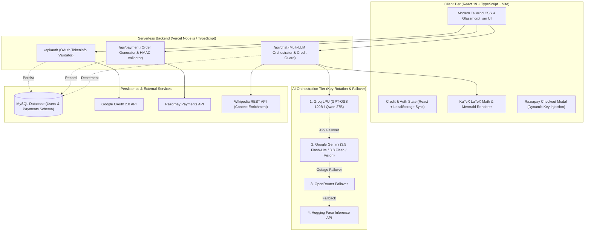

# 🎓 AYMAN STUDY AI — Production AI Academic Platform

[](https://ayman-study-ai.vercel.app)
[](https://www.linkedin.com/in/mohammed-ayman-s-661396289)
[](https://github.com/MohammedAyman07)
[](https://react.dev/)
[](https://www.typescriptlang.org/)
[](LICENSE)

> **Built & Engineered by [Mohammed Ayman S](https://www.linkedin.com/in/mohammed-ayman-s-661396289)**  
> *Full-Stack Software Engineer & AI Systems Developer*

---

## 👨‍💻 Note for Technical Recruiters & Engineering Hiring Managers

> *"I engineered **AYMAN STUDY AI** as an end-to-end, production-grade SaaS application that solves a real academic challenge: generic chatbots hallucinate formulas and produce conversational text that doesn't follow exam grading boards.  
> 
> Rather than a superficial API wrapper, this project demonstrates end-to-end full-stack software engineering: **zero-downtime multi-model AI failover pools**, **cryptographic HMAC-SHA256 payment verification with Razorpay**, **Google OAuth 2.0 verification**, **atomic credit accounting in MySQL with offline resilience**, and **real-time KaTeX LaTeX math & Mermaid.js rendering**."*  
> 
> — **Mohammed Ayman S** | [LinkedIn](https://www.linkedin.com/in/mohammed-ayman-s-661396289) | [GitHub](https://github.com/MohammedAyman07)

---

## 📑 Table of Contents
1. [Core Engineering Highlights](#-core-engineering-highlights)
2. [Key Architecture & Data Flow](#-system-architecture)
3. [Deep-Dive: Technical Challenges & Solutions](#-technical-deep-dive--challenges-solved)
   * [1. Zero-Downtime Multi-Model AI Orchestrator](#1-zero-downtime-multi-model-ai-orchestration--failover)
   * [2. End-to-End Cryptographic Payment Processing (Razorpay)](#2-cryptographic-payment-gateway-integration-razorpay)
   * [3. Secure Authentication & Recruiter Guest Access](#3-authentication-google-oauth-20--guest-demo)
   * [4. Atomic Credit Economy & Dual-State Persistence](#4-atomic-credit-economy--dual-persistence-engine)
   * [5. Academic Solution Formatter with LaTeX & Mermaid.js](#5-pedagogical-rendering-engine-katex-latex--mermaidjs)
4. [Technology Stack](#-technology-stack--skills-matrix)
5. [Verified Implemented Features](#-verified-features)
6. [Security & Defense-in-Depth](#-security-implementation)
7. [Local Setup & Testing Guide](#-local-development-setup)
8. [Author & Contact Information](#-author--contact)

---

## 🌟 Core Engineering Highlights

* 🔄 **Zero-Downtime Multi-Model AI Cascade:** Built a self-healing LLM orchestration engine in serverless TypeScript that rotates across **Groq LPUs**, **Google Gemini multimodal vision**, **OpenRouter**, and **Hugging Face**. If any provider suffers a 429 rate limit or outage, requests failover seamlessly in milliseconds without the user noticing.
* 💳 **Cryptographic Payment Gateway (Razorpay):** End-to-end payment workflow with serverless order generation, dynamic currency detection (INR, USD, EUR via IP geolocation), and **cryptographic HMAC-SHA256 signature verification** before crediting accounts.
* 🔐 **Enterprise Identity (Google OAuth 2.0 & Token Verification):** Server-side verification of Google ID tokens against Google’s official OAuth2 endpoints, paired with a custom base64 session token system and a **1-click Recruiter Demo access button** for zero-friction candidate review.
* ⚡ **Atomic Credit Economy (-1 Credit per Query):** Guaranteed subtraction across every single AI solve, chat query, quiz generation, and note summarizer with real-time UI badges, browser `localStorage` persistence, and optional MySQL database accounting.
* 📐 **KaTeX Mathematical Typesetting & Dynamic Visuals:** Custom regex parsing pipeline that isolates display math blocks (`$$ ... $$`), renders formulas with KaTeX, and automatically prompts LLMs to generate valid Mermaid.js diagrams for circuits, graphs, and biology flowcharts.

---

## 🏗️ System Architecture



---

## 💡 Technical Deep-Dive & Challenges Solved

### 1. Zero-Downtime Multi-Model AI Orchestration & Failover
* **The Problem:** Free-tier and single-provider AI APIs frequently suffer from aggressive 429 rate limits, token budget depletion, or unexpected outages.
* **The Solution:** I engineered a multi-tier serverless orchestration pipeline in [`api/chat.ts`](api/chat.ts):
  * **Multi-Key Rotation Pool:** Accepts comma-separated key pools (`GROQ_API_KEYS`, `GEMINI_API_KEYS`). On every incoming query, it selects an active key using randomized load balancing.
  * **Intelligent Routing for Multimodal Tasks:** If the student uploads an image (Snap & Solve), the router automatically prioritizes Google Gemini’s multimodal vision models (`gemini-3.5-flash-lite`, `gemini-3.8-flash`) and Hugging Face Vision (`Qwen2-VL-7B`). Text queries route to ultra-low-latency Groq LPU models (`openai/gpt-oss-120b`, `qwen/qwen3.8-27b`).
  * **Zero-Crash Execution:** If an API rejects a request with an error, the error is trapped in a non-fatal `try/catch` loop that cascades immediately to the next available provider.

### 2. Cryptographic Payment Gateway Integration (Razorpay)
* **The Problem:** Frontend client-side payment confirmations are vulnerable to tampering and man-in-the-middle attacks.
* **The Solution:** Built a strict, two-step backend transaction pipeline in [`api/payment.ts`](api/payment.ts):
  1. **Order Creation:** Backend securely contacts Razorpay with basic auth credentials to create a verified `order_id` in paise/smallest currency unit.
  2. **Dynamic Public Key Injection:** Public keys are returned directly from the backend order response, decoupling frontend builds from hardcoded secrets.
  3. **Cryptographic HMAC-SHA256 Verification:** After user payment, the frontend passes `razorpay_order_id`, `razorpay_payment_id`, and `razorpay_signature` to the server. The server computes:
     ```text
     Expected Signature = HMAC_SHA256(order_id + "|" + payment_id, RAZORPAY_KEY_SECRET)
     ```
     Credits are credited **only if the generated hash matches the signature byte-for-byte**.
  4. **Currency Fallback:** Automatically catches Indian accounts attempting international currency (`USD`/`EUR`) orders and falls back to standard `INR` (₹99).

### 3. Authentication: Google OAuth 2.0 & Guest Demo
* **The Problem:** Recruiters and evaluators reviewing a portfolio repository often hesitate to link personal Google accounts just to test application features.
* **The Solution:**
  * **Production OAuth 2.0:** Integrated `@react-oauth/google` with a dedicated serverless authentication handler [`api/auth.ts`](api/auth.ts) that verifies tokens against Google's `https://oauth2.googleapis.com/tokeninfo` endpoint.
  * **1-Click Recruiter Guest Access:** Added an instant "Guest Demo" button that provisions a temporary verified session with **20 complimentary credits**, allowing hiring managers to explore all features (Math Solver, Chemistry Derivations, AI Quiz) in 1 click.

### 4. Atomic Credit Economy & Dual-Persistence Engine
* **The Problem:** Stateless serverless functions lose memory across invocations, which previously caused student credit counters to reset to default upon browser refresh.
* **The Solution:**
  * **Live Client Countdown:** Every request deducts exactly 1 credit (`credits = Math.max(0, credits - 1)`).
  * **LocalStorage Syncing:** Synced React state with browser storage (`ayman_study_user`, `ayman_study_token`) so sessions and balances persist across tab closures and refreshes.
  * **MySQL Database Integration:** Designed [`database.sql`](backend/php/database.sql) with parameterized queries for persistent cloud storage:
    ```sql
    UPDATE users SET credits = credits - 1 WHERE google_id = ? OR email = ?;
    ```
  * **Defensive Timeout Safeguard:** Set a 2500ms connection timeout on MySQL so that if the remote database is unreachable, the system gracefully maintains session tracking rather than failing with HTTP 500.

### 5. Pedagogical Rendering Engine: KaTeX LaTeX & Mermaid.js
* **The Problem:** Standard LLM outputs blend prose and formulas into unreadable inline markdown walls.
* **The Solution:**
  * Enforced strict prompt boundaries instructing models to output pure vertical calculations inside display math blocks (`$$ ... $$`).
  * Integrated **KaTeX** with `remark-math` and `rehype-katex` for ultra-crisp, GPU-accelerated formula typography.
  * Integrated a custom Wikipedia REST API context enrichment hook that extracts verified historical facts for humanities questions.
  * Dynamic visual prompting prompts the LLM to output valid **Mermaid.js** code blocks whenever graphs, circuit diagrams, or biochemical pathways are relevant.

---

## 🛠️ Technology Stack & Skills Matrix

| Domain | Technologies & Libraries | Practical Competency Demonstrated |
| :--- | :--- | :--- |
| **Frontend Core** | React 19, TypeScript 5.8, Vite 6 | Component modularity, typed state, modern hooks, Vite build pipeline |
| **Styling & UI** | Tailwind CSS 4, Framer Motion, Lucide Icons | Responsive design, glassmorphic styling, smooth layout transitions |
| **Math & Data Viz**| KaTeX, Mermaid.js, React-Markdown, Rehype | Custom math parsing, SVG diagram rendering, code fence isolation |
| **Backend Architecture** | Vercel Serverless (Node.js), PHP 8.2 (LAMP fallback) | Serverless microservices, REST design, connection pooling, clean URLs |
| **Database & Storage** | MySQL / MariaDB, Browser LocalStorage | Relational schemas, ACID transactions, dual-tier client/server persistence |
| **Security & Auth** | Google OAuth 2.0, HMAC-SHA256, CORS Headers | Cryptographic hashing, token verification, zero-client secret leakage |
| **AI & LLM Services**| Groq LPU, Google Gemini API, OpenRouter, HuggingFace | Multimodal vision OCR, load balancing, multi-model cascade failover |
| **Payments** | Razorpay Gateway, Dynamic IP Geolocation | Dynamic order creation, international currency adaptation, webhooks |

---

## 🚀 Verified Features

- [x] **Multi-Subject AI Solver (13+ Syllabi):** Mathematics, Physics, Chemistry, Biology, Botany, Zoology, Computer Science, English Literature, Tamil Grammar, History, Commerce, Accountancy, and Economics.
- [x] **Snap & Solve (Multimodal Vision AI):** Upload photos of handwritten or printed textbook problems for instant step-by-step LaTeX derivations.
- [x] **AI Quiz Generator & Assessment Engine:** Generates interactive MCQs for any topic and class level with a real-time question runner, score analytics, and explanations.
- [x] **Context-Aware Study Buddy Chat:** Persistent conversational thread under every solved answer to clarify specific derivation steps.
- [x] **Exam Answer Summarizer:** Condenses long essays and past papers into key grading criteria and bulleted revision points.
- [x] **Pre-loaded Physics Chapter Banks:** Unit-wise MCQs covering Electrostatics, Current Electricity, and Magnetism.
- [x] **Dual Deployment Support:** Ready out-of-the-box for **Vercel Serverless** or traditional **Hostinger / Apache LAMP** hosting.

---

## 🔒 Security Implementation

1. **Zero Secret Leakage:** No API secrets are exposed via `VITE_` public variables. All private keys (`GROQ_API_KEY`, `GEMINI_API_KEY`, `RAZORPAY_KEY_SECRET`, `DB_PASS`) remain strictly inside server-side environments.
2. **Defensive Git Policy:** The repository's [`.gitignore`](.gitignore) is pre-configured to exclude all `.env`, `.env.local`, and credential files.
3. **Cryptographic Validation:** Payments cannot be spoofed without the private server-side secret key.
4. **OWASP HTTP Security Headers:** Configured via [`vercel.json`](vercel.json):
   * `X-Content-Type-Options: nosniff`
   * `X-Frame-Options: DENY`
   * `X-XSS-Protection: 1; mode=block`
   * `Referrer-Policy: strict-origin-when-cross-origin`

---

## ⚙️ Local Development Setup

### 1. Clone the Repository
```bash
git clone https://github.com/MohammedAyman07/ayman-study-ai.git
cd ayman-study-ai
```

### 2. Install Dependencies
```bash
npm install
```

### 3. Configure Environment Variables
Copy `.env.example` to `.env`:
```bash
cp .env.example .env
```
Populate your keys (only test/development keys needed locally):
```env
GROQ_API_KEY=your_groq_key
GEMINI_API_KEY=your_gemini_key
RAZORPAY_KEY_ID=your_razorpay_key
RAZORPAY_KEY_SECRET=your_razorpay_secret
VITE_GOOGLE_CLIENT_ID=your_google_oauth_client_id
```

### 4. Run Development Server
```bash
npm run dev
```
Open **`http://localhost:5173`** in your browser.

### 5. Run Type Safety & Production Build
```bash
npm run lint    # Strict TypeScript typecheck via tsc --noEmit
npm run build   # Production Vite bundle build
```

---

## 👨‍💻 Author & Contact

**Mohammed Ayman S**  
*Full Stack Software Engineer & AI Systems Developer*

* 🌐 **Live Website:** [ayman-study-ai.vercel.app](https://ayman-study-ai.vercel.app)
* 💼 **LinkedIn Profile:** [linkedin.com/in/mohammed-ayman-s-661396289](https://www.linkedin.com/in/mohammed-ayman-s-661396289)
* 🐙 **GitHub Profile:** [@MohammedAyman07](https://github.com/MohammedAyman07)
* 📧 **Email:** [mohammedayman0107@gmail.com](mailto:mohammedayman0107@gmail.com)

---

## 📄 License

This project is open-source and distributed under the [Apache License 2.0](LICENSE).
